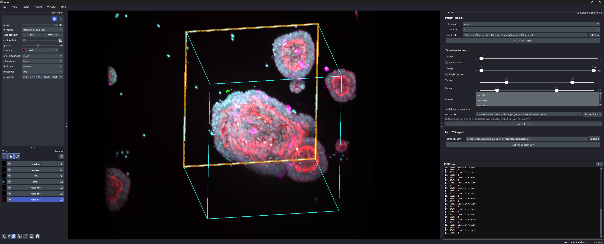
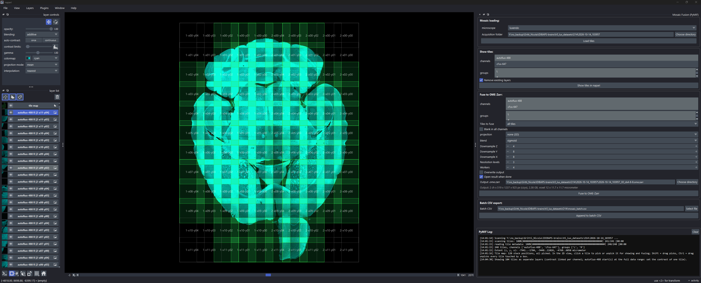

# Napari plugin

PyMIF provides napari widgets for conversion and mosaic fusion. After installing the napari extras (`pip install -e .[napari]`), they are in the `Plugins > PyMIF` menu.

## Converter

The conversion widget is available from:

`Plugins > PyMIF > Converter Plugin`

The widget can load data, preview channels, define a 3D ROI, restrict z/time/channel ranges, choose pyramid settings, and export to OME-Zarr. For axis-aware zarr datasets, controls tied to missing axes are disabled; for example, a dataset with `axes="yx"` has no active T slider or channel selector.

The widgets are built to be docked on any side of the napari window, or floated, and to stay usable at small sizes:

- The three boxes (dataset loading, dataset conversion, batch CSV export) sit in one scroll area, so nothing is cut off in a narrow or short dock.
- In the **Dataset conversion** box, the arrow in its title expands or collapses the parameters in place. The **Convert to zarr** button stays inside the box and visible when they are collapsed, and is disabled while a conversion runs.
- Above the button, a line recaps the output at full resolution and follows the T/Z/Y/X ranges, the selected channels and **Drop singleton axes**, for example `3 t x 2 ch x 120 x 1024 x 1024 px (tczyx), 1.51 GB, voxel 2 x 0.65 x 0.65 micrometer`. The size is uncompressed, so the files on disk are usually smaller.
- The log is a separate pane under a drag handle: drag it taller to see more lines, or shorter to give room to the parameters. Progress bars update a single line instead of filling the log.

## Mosaic Fusion

`Plugins > PyMIF > Mosaic Fusion` loads the raw tiles of a mosaic, shows them as one layer per tile at its stage position, and fuses them into an OME-Zarr image in the background, with a live estimate of the output size. See [Mosaics](mosaic.md#napari) for details.

