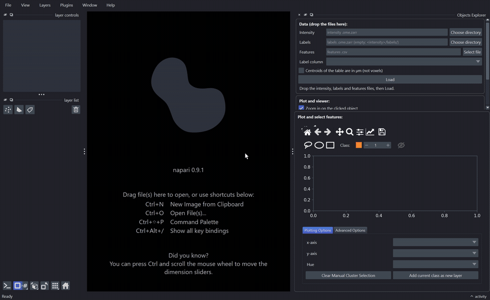

# Napari plugin

ZarrSmith provides napari widgets for conversion, mosaic fusion and the exploration of segmented objects. After installing the napari extras (`pip install -e .[napari]`), they are in the `Plugins > ZarrSmith` menu.

## Converter

The conversion widget is available from:

`Plugins > ZarrSmith > Converter Plugin`

The widget can load data, preview channels, define a 3D ROI, restrict z/time/channel ranges, choose pyramid settings, and export to OME-Zarr. For axis-aware zarr datasets, controls tied to missing axes are disabled; for example, a dataset with `axes="yx"` has no active T slider or channel selector.

The widgets are built to be docked on any side of the napari window, or floated, and to stay usable at small sizes:

- The three boxes (dataset loading, dataset conversion, batch CSV export) sit in one scroll area, so nothing is cut off in a narrow or short dock.
- In the **Dataset conversion** box, the arrow in its title expands or collapses the parameters in place. The **Convert to zarr** button stays inside the box and visible when they are collapsed, and is disabled while a conversion runs.
- Above the button, a line recaps the output at full resolution and follows the T/Z/Y/X ranges, the selected channels and **Drop singleton axes**, for example `3 t x 2 ch x 120 x 1024 x 1024 px (tczyx), 1.51 GB, voxel 2 x 0.65 x 0.65 micrometer`. The size is uncompressed, so the files on disk are usually smaller.
- The log is a separate pane under a drag handle: drag it taller to see more lines, or shorter to give room to the parameters. Progress bars update a single line instead of filling the log.


## Mosaic Fusion

`Plugins > ZarrSmith > Mosaic Fusion` loads the raw tiles of a mosaic, shows them as one layer per tile at its stage position, and fuses them into an OME-Zarr image in the background, with a live estimate of the output size. See [Mosaics](mosaic.md#napari) for details.


## Objects Explorer



*A table from three images: hovering a point shows a thumbnail of its object; clicking a point of another image shows that image and goes to the object; unticking an image removes its objects from the plot.*

`Plugins > ZarrSmith > Objects Explorer` plots the features of segmented objects with [napari-clusters-plotter](https://github.com/BiAPoL/napari-clusters-plotter) and links the plot with the viewer. It loads three things, dropped on their field, dropped all at once anywhere on the panel, or browsed:

- the intensity OME-Zarr (all channels and resolution levels, read lazily),
- the labels OME-Zarr (optional: else the first group in `<intensity>.ome.zarr/labels/`),
- a CSV with one row per object: a label column and any features.

**Load** reads them in the background, then adds one layer per channel and the labels layer, and plots the first features of the table. The plot sits under the panel, behind a drag handle, with everything napari-clusters-plotter can do: x / y features, colour of the plot and of the labels by any feature, selections (lasso, ellipse, rectangle) to make clusters, 2D histogram. The plot is linked with the viewer:

- **Click a point**: the viewer goes to that object (its plane, centred and zoomed in) and selects its label. Turn off the zoom and pan tools of the plot first: while one of them is on, clicks don't select points.
- **Hover a point**: a thumbnail of the object appears next to the mouse, with XY and XZ views through its centre and the object outlined in magenta.
- **Pick a label in napari**: its point is highlighted in the plot.

Where the objects are comes from centroid columns of the CSV: `centroid-0/1/2` (skimage `regionprops_table`), `centroid_z/y/x` or `z/y/x`, in voxels of the labels at full resolution, or in µm (tick the box). Without them the centroids are computed from a low resolution level of the labels; this is slow for big images and can miss small objects. The size of the thumbnail comes from `bbox-*` columns (regionprops) or a size column (`area`, `volume`, ...).

In the table, text columns become categories (1, 2, ...) and `inf` values become NaN. Those objects are then missing from plots of that feature.

Each object needs a single row. If a label appears several times, the table is not loaded and a message says which label is repeated. This usually means the table comes from several images: see below.

### A table from several images

A table with the columns `image_path` and `labels_path` describes objects from several images. Each row gives the intensity and labels OME-Zarr of its object's image, relative to the folder of the table (absolute paths work too; `\` is read as `/`, so a table written on Windows also works on Linux):

```
label,image_path,labels_path,area,solidity
12,images/sample_01.ome.zarr,labels/sample_01_labels.ome.zarr,523,0.91
12,images/sample_02.ome.zarr,labels/sample_02_labels.ome.zarr,388,0.87
```

The labels are always separate files in this mode. The **Intensity** and **Labels** fields are then not used, and greyed out.

After **Load**, the panel lists the images of the table with their number of objects. Images whose files can't be found are greyed out, with the reason.

- **Tick the images to plot**: the plot shows the objects of the ticked images only. **All** ticks all of them, **Only the shown one** keeps just the image in the viewer. At least one image stays ticked.
- **The viewer shows one image at a time**, in bold in the list. Clicking a point of another image reads that image and shows it in the same layers, then goes to the object. Double-clicking an image in the list shows it too.
- **Thumbnails** work for the objects of any ticked image; each image is read the first time it is needed.
- The feature `image_index` (1, 2, ... as numbered in the list) is added, so the plot or the labels can be coloured by image. Clusters drawn in the plot are kept when images are unticked and ticked again.

The same widget opens from a script, with the files given on the command line: `python examples/label_features_explorer.py image.ome.zarr labels.ome.zarr features.csv`.
